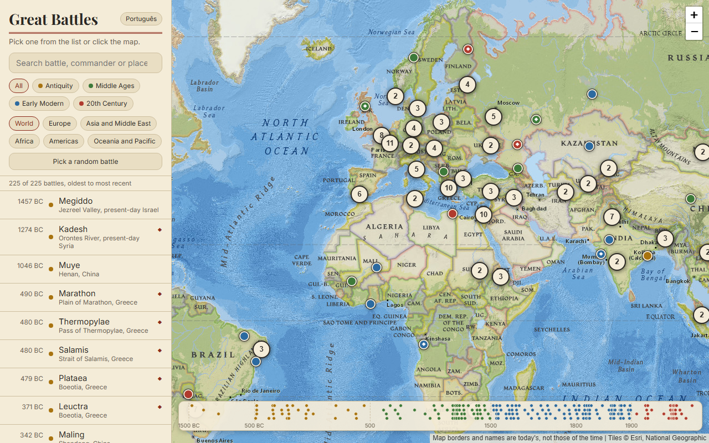
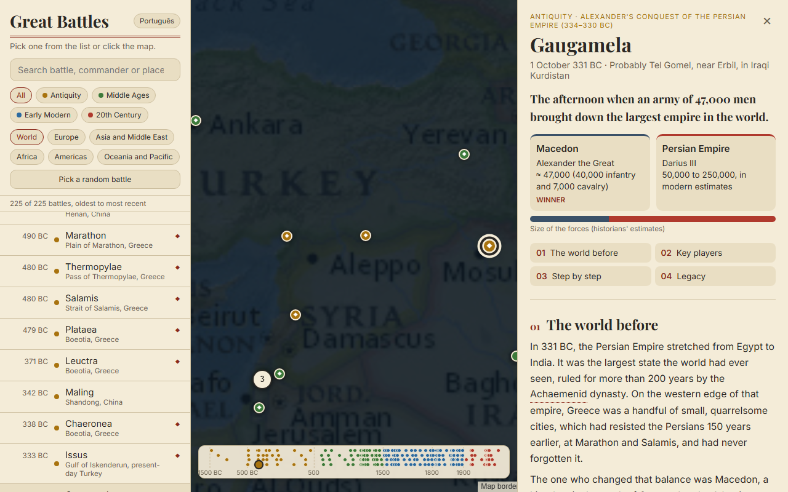
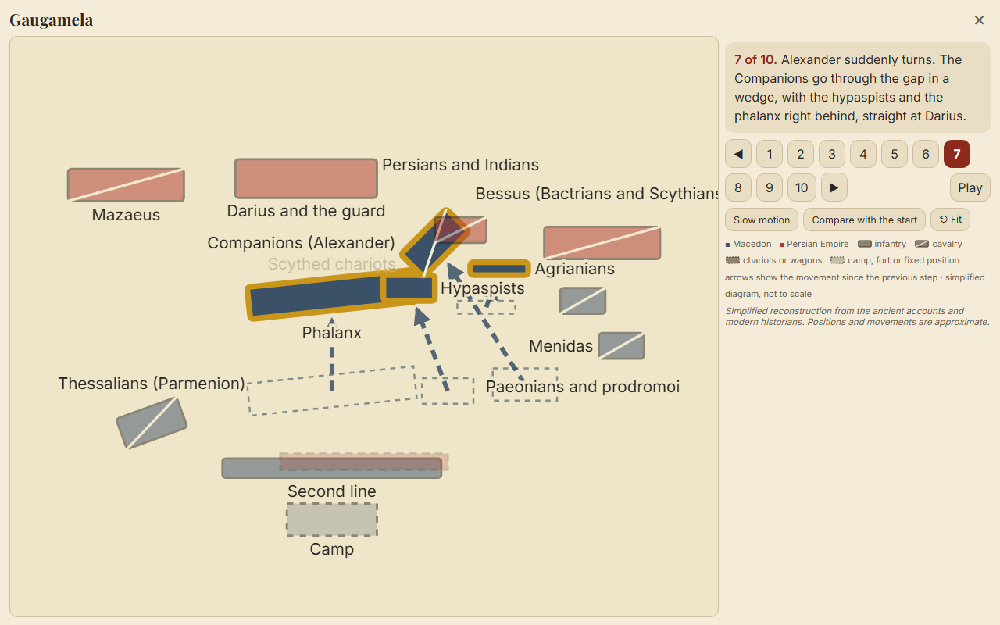

# Great Battles

**A free interactive map of 253 battles that shaped history, from Megiddo (1457 BC) to the 20th century, in English and Portuguese.**

**Live:** https://banzaki.github.io/great-battles/

Pick a battle on the map or the timeline and you get the whole story: the world before it, the people who led it, the battle step by step, and what it changed. For 151 of them, an animated diagram shows the armies moving, and the Battle Theatre opens that diagram full screen with zoom and pan.

## Why

History books tell you *what* happened at Cannae or Gaugamela; few show you *where* it happened and *how* the armies moved. Great Battles puts both on one page: a world map to discover battles you never heard of, and a diagram to watch the ones you know unfold.

## What's inside

- **253 battles** across every continent and era, each with four chapters, a timeline, glossary terms you can tap, and notes where historians disagree.
- **151 animated deployment diagrams** (7 to 10 steps each): units glide between positions, arrows and ghost outlines show where they came from, and the units that act in each step are highlighted.
- **The Battle Theatre:** the diagram full screen, with wheel and pinch zoom, drag, slow motion and a before/after comparison. It works on phones in portrait and landscape.
- **Two languages:** English and Portuguese, switchable from the header.

## How it was built

- **Stack:** plain HTML, CSS and JavaScript, no framework and no build step. [Leaflet](https://leafletjs.com/) with marker clustering for the map, Esri National Geographic tiles, GitHub Pages for hosting.
- **Data as code:** every battle is a plain JavaScript data file (cards, in-depth chapters, diagram positions per step), so adding a battle is adding data, not code.
- **Diagram engine:** units, terrain and steps are drawn as inline SVG from the data. Labels are placed automatically so they avoid each other, the units and the terrain names. That cut overlapping labels from 589 diagram steps to 3, out of 1,072. The view fits itself to where the armies actually are.
- **Content and accuracy:** the texts were written with AI assistance (Claude) and checked against sources: English and Portuguese Wikipedia and the works they cite, Britannica, and primary-source translations where available. Ancient and chronicle numbers are flagged as such, and legends are marked as legends.
- **Translation:** each Portuguese data file has an English twin. A small checker script compares the two files' structure and flags glossary links that changed or don't resolve, and text that still looks untranslated.
- **Privacy-friendly analytics:** an anonymous visit counter (PostHog, plain HTTP API). It uses no cookies, creates no person profiles and records no sessions, and it turns off under Global Privacy Control or Do Not Track.

## Launch results

Posted on Reddit on the night of 22 November 2026. In the first 12 hours (PostHog):

| | |
|---|---|
| Visitors | 585 |
| Page views | 721 |
| Battles opened | 2,420 (about 4 per visitor) |
| Visitors from Reddit | about 310 |
| Top countries | USA 296 · Portugal 54 · Canada 34 · UK 25 · Germany 23 |
| Most opened | Gettysburg 75 · Aljubarrota 55 · Cannae 42 |

The launch post reached 51 upvotes and 20 comments on r/ancientrome, 37 upvotes on r/ancienthistory and 22 on r/Napoleon.

**Shipped from reader feedback the same day:**
- A reader asked for a swipe gesture to close a battle and go back to the map on mobile. It shipped a few hours later, and the reply went back in the same thread.
- Another reader pointed out that the battles of Genghis Khan's rise were missing. The same day, an 8-battle steppe pack added Chakirmaut (1204), where Temujin broke the Naimans, and Kazakh battles down to the 1720s.
- Readers asked for more naval battles, so an 8-battle naval pack followed, from Mylae (260 BC) to Leyte Gulf (1944), each with a ship diagram.
- Readers and the author noticed empty areas on the map, so a 20-battle regional pack followed: southern France, Catalonia and northern Italy, from Vouillé (507) to the Ebro (1938).

## Credits

Map tiles © Esri, National Geographic. Map borders and names are today's, not those of the time. Battle diagrams are simplified reconstructions, not to scale.
